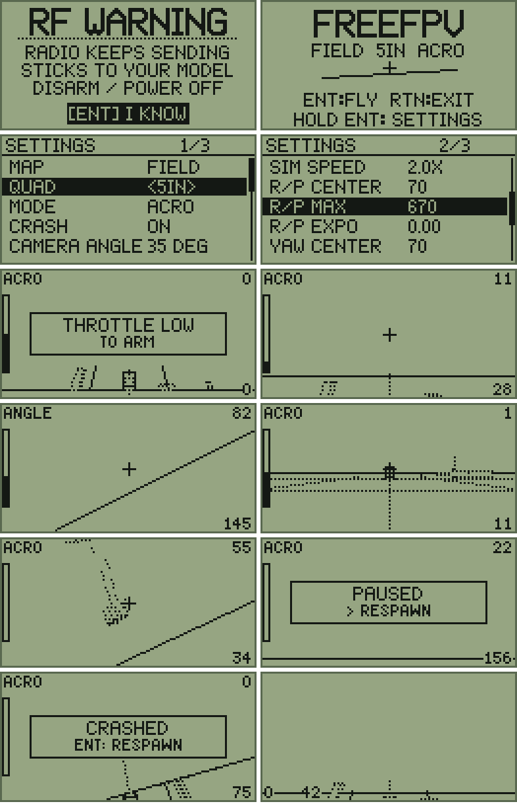

# FreeFPV

An FPV **acro trainer** for **EdgeTX radios with a 128×64 black & white screen** (Radiomaster TX12 / TX12 MK2 /
Boxer / Pocket / GX12 / Zorro, Jumper T-Pro / T-Lite / T20 — the `PCB=X7` family).

You look through the quad's camera and fly it with your sticks like a real quad: roll, pitch and yaw sticks set
rotation **rates** (Betaflight "actual rates"), throttle sets thrust, centred sticks hold the attitude. Flips,
rolls, inverted flight, all of it. A small wireframe world with fixed obstacles; no score, no levels.



## Install

1. Copy `dist/SCRIPTS/TOOLS/freefpv.lua` **and the whole folder** `dist/SCRIPTS/TOOLS/FREEFPV/` to
   `/SCRIPTS/TOOLS/` on the SD card:

   ```
   SD card
   └── SCRIPTS/TOOLS/
       ├── freefpv.lua        <- the launcher shown in TOOLS
       └── FREEFPV/           <- the game (config, menus, flight, render, solid, 4 maps) + your settings
   ```
2. On the radio: **SYS** → **TOOLS** → **FreeFPV**.

The radio compiles each file the first time it is used (a `.luac` appears next to it), so the first launch and
the first flight take a moment. When updating, delete the old `.luac` files or copy everything again.

## RF warning

The radio **keeps transmitting your sticks to the bound model while you play**. Disarm, better power the model
off, before pressing ENT on the first screen.

## Controls

| where | input | action |
|---|---|---|
| warning | ENT / RTN | continue / exit |
| title | ENT · hold ENT · RTN | fly · settings · exit |
| arming | throttle | **throttle low to arm** (like a real quad); RTN back to the title |
| flying | sticks | Ail = roll, Ele = pitch, Rud = yaw, Thr = thrust; RTN = pause |
| pause | roller / PAGE, ENT | RESUME · RESPAWN · QUIT (RTN also quits) |
| crashed | — | respawns on the ground after 1.5 s (ENT for sooner) |

Sticks are read by function (`ail`, `ele`, `thr`, `rud`), so your radio's own stick mode applies — nothing to set.

## How it flies

- **ACRO:** the sticks command rotation rates with the Betaflight *actual rates* formula
  (`rate = x·center + (max − center)·|x|·(x⁵·expo + x·(1 − expo))`); centred sticks keep the current angle.
- **ANGLE:** self-levelling; the roll/pitch sticks set a tilt up to 55°. Yaw is still a rate.
- Thrust along the quad's up axis, gravity, drag (linear + quadratic → a top speed), air-mode style (rates work
  at zero throttle).
- **SIM SPEED** (default **2.0×**) runs all movement — gravity, thrust, drag, speed — faster than real time, so
  falls and dives feel like a real quad. Rotation stays real time: your rates mean exactly what they say.
  Physics runs 4 × SIM SPEED steps per 50 ms frame (collisions stay exact at any speed).
- **Ground:** a soft touchdown lands (settles level). With **CRASH ON**, hitting the ground hard (fast, steep or
  tilted) or touching an obstacle is a crash → respawn. A **whoop bounces** off obstacles instead (ducts).
  With **CRASH OFF** you slide along obstacles and never crash.
- **Camera:** ~116° wide, tilted up by CAMERA ANGLE, so you have to lean forward to fly forward.

### Quads

| QUAD | thrust/weight | hover | top speed | feel | camera |
|---|---|---|---|---|---|
| WHOOP | 2.5 | ~40 % | ~36 km/h | soft, stops fast, bounces off things | 15° |
| 2.5IN | 4 | ~25 % | ~70 km/h | quick | 20° |
| 3IN | 5 | ~20 % | ~90 km/h | quick | 25° |
| 3.5IN | 6 | ~17 % | ~110 km/h | sharp | 30° |
| 5IN | 8 | ~13 % | ~140 km/h | sharpest, carries speed | 35° |

### Maps (only the selected one is loaded, only while flying)

| MAP | what's there |
|---|---|
| FIELD | open field, a gate straight ahead, a few boxes and poles |
| GATES | a 60 × 80 m loop of six gates |
| POLES | a slalom line ahead, then a small pole forest |
| CITY | eight blocks with 8 m streets and a square in the middle, a gate at the entrance |

## Screen

Horizon (solid line, rolls with you; when it is out of view — nose up with a high camera angle — it is pinned,
dotted, to the screen edge with the same tilt, so it is always visible), dotted ground grid around you, obstacles drawn **solid**: everything is
drawn far to near and each box hides what is behind it (grid, horizon, other buildings); only the faces you can
see get their edges drawn. Near objects have solid edges, far ones dotted; gates stay see-through. HUD: crosshair, throttle bar (left), ACRO/ANGLE, altitude in m (top right), speed in km/h (bottom
right). DEBUG adds the live frame rate (FPS, 20 is the most an EdgeTX script can get) and the Lua memory in KB at the
bottom left.

## Settings (hold ENT on the title; saved to `/SCRIPTS/TOOLS/FREEFPV/freefpv.cfg`)

| setting | range | default |
|---|---|---|
| MAP | FIELD / GATES / POLES / CITY | FIELD |
| QUAD | WHOOP / 2.5IN / 3IN / 3.5IN / 5IN (also sets CAMERA ANGLE) | 5IN |
| MODE | ACRO / ANGLE | ACRO |
| CRASH | ON / OFF | ON |
| CAMERA ANGLE | 0–60°, step 5 | 35° |
| SIM SPEED | 1.0×–3.0×, step 0.5 (movement speed; rotation stays real time) | 2.0× |
| R/P CENTER, R/P MAX, R/P EXPO | 10–400 °/s · 100–1800 °/s · 0.00–1.00 | 70 · 670 · 0.00 (Betaflight defaults) |
| YAW CENTER, YAW MAX, YAW EXPO | same | 70 · 670 · 0.00 |
| HUD | ON / OFF | ON |
| DEBUG | ON / OFF | OFF |

## Development

Same setup as GateRush: `src/` modules, `src/main.lua` is the launcher; `tools/build.lua` copies them into the SD
image in `dist/`. Two groups are never in memory together: **menus** (`menus`) and **flight** (`flight`, `render`
and the selected map, whose data is copied and the file dropped). `config` stays loaded.

| command (Lua 5.2; on Windows `lua52.exe`) | what |
|---|---|
| `lua5.2 tools/build.lua` | build `dist/` |
| `lua5.2 tests/run_all.lua` | rates, physics, render (projection, clipping, no allocation), world (maps, budget, gates), menus, 13 screen goldens (src and dist) |
| `lua5.2 tools/soak.lua 600` | random flying on every map × quad × crash setting |
| `lua5.2 tools/memory.lua` | compile memory per file, Lua heap in menus and in flight |
| `lua5.2 tools/cost.lua` | Lua instructions and C calls per frame in heavy CITY views (compares versions the way the radio would) |
| `make sim` / `python tools/simhost/simu_host.py ...` | run it in the real EdgeTX firmware (Companion 2.12 DLLs), then `lua5.2 tools/simhost/compare.lua out/simu/fly out/simu/settings` |

New golden after an intended visual change: `APPROVE=1 lua5.2 tests/run_all.lua test_screens`, look at
`out/screens/*.pbm` (`python tools/snapshot.py png <pbm> <png>`), commit.

## Tested

| radio | mock | EdgeTX 2.12 firmware on PC | real radio |
|---|---|---|---|
| GX12 | ✓ all tests | ✓ fly, crash, settings; 6 screens pixel-identical to the mock | not yet |
| TX12, Boxer, Pocket | (same target) | ✓ fly scenario, no errors | not yet |

MIT license.
